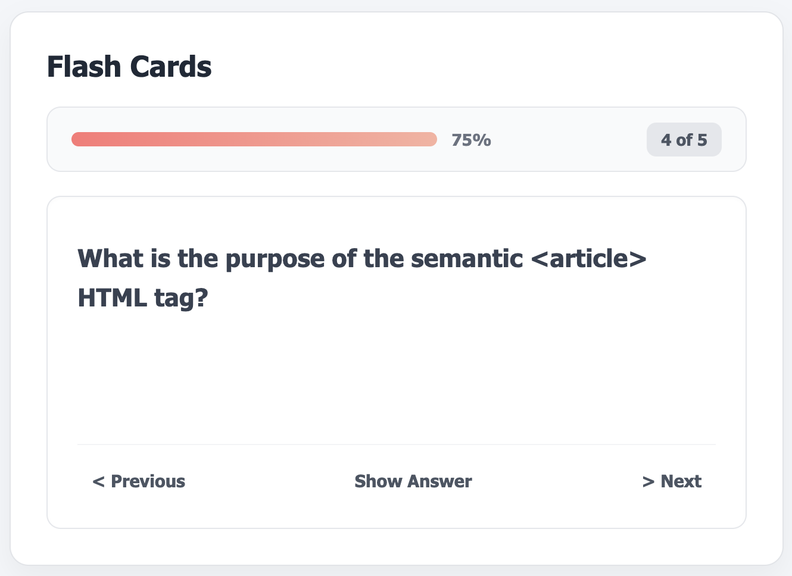

# Flash Cards

A simple flash card app for testing your knowledge of HTML, CSS, and JavaScript fundamentals. Flip through pre-defined questions one at a time, reveal the answer, and track your progress with a progress bar.

This project is based on the [Flash Cards](https://roadmap.sh/projects/flash-cards) beginner project from [roadmap.sh](https://roadmap.sh).

**Author:** Kunal Guhagarkar

## Preview



*The app shows one question at a time with a progress bar, a question counter, and Previous / Show Answer / Next controls.*

## Features

- Pre-defined flash cards with questions and answers
- View one card at a time and flip to reveal the answer
- Progress bar and percentage showing how far along you are
- Question counter (e.g. "3 of 5")
- Previous / Next navigation to cycle through the cards

## Tech Stack

- HTML5
- CSS3
- Vanilla JavaScript (no frameworks or build step)

## Project Structure

```
.
├── index.html   # Page markup
├── style.css    # Styling
├── script.js    # Card data and app logic
└── README.md
```

## Getting Started

No installation is needed.

1. Clone or download this repository.
2. Open `index.html` in any modern web browser.

## How to Use

1. Read the question shown on the card.
2. Click **Show Answer** to reveal the answer (the button changes to **Show Question** so you can flip back).
3. Click **Next >** or **< Previous** to move between cards.
4. Watch the progress bar fill as you move through the deck.

## Customizing the Cards

Questions and answers live in two parallel arrays at the top of `script.js`. Add a new card by appending to both arrays at the same index:

```js
const questions = [
    "What does HTML stand for?",
    // add your question here
];

const answers = [
    "HyperText Markup Language",
    // add the matching answer here
];
```

## Possible Improvements

- Refactor to a component-based framework such as React, Vue, or Angular (the original goal of the roadmap.sh project)
- Combine questions and answers into a single array of objects
- Add a card flip animation
- Shuffle the deck and track correct/incorrect answers
- Add keyboard shortcuts (arrow keys to navigate, space to flip)
- Escape or sanitize answers containing HTML such as `<script>` when rendering

## Acknowledgements

Project idea from [roadmap.sh](https://roadmap.sh/projects/flash-cards): https://roadmap.sh/projects/flash-cards

## Author

Kunal Guhagarkar